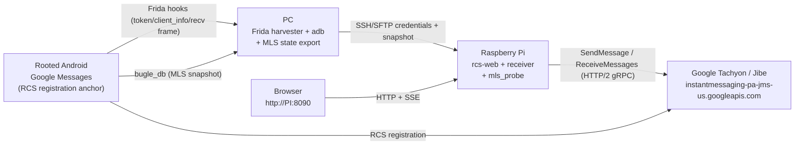

# Pi RCS Client

Run an independent RCS conversation from a Raspberry Pi, using an Android phone only as the RCS registration/credential anchor.

The Pi can:

- send plaintext RCS messages through Google Tachyon/Jibe
- receive RCS messages directly from Google
- decrypt inbound E2EE (`message/mls`) with `mls-rs`
- expose a Google Messages-like web UI (contacts, threads, live chat)
- keep working when the phone screen is off, as long as valid credentials are available

The Android phone is not mirrored. The Pi talks to Google directly over gRPC/HTTP2. The phone is used to mint/refresh Tachyon credentials and to provide the MLS group state.

> **Security / authorization:** use only numbers you own or are explicitly authorized to test. This project is for personal/authorized research, not for unsolicited messaging or mass targeting.

---

## Status

| Capability | Status |
|---|---|
| Pi plaintext send | ✅ verified |
| Pi direct receive | ✅ verified with phone `ReceiveMessages` credentials |
| E2EE decrypt | ✅ verified (`mls_probe` + MLS snapshot) |
| MLS epoch / commit handling | ✅ verified (vendored `mls-rs` patch) |
| Web UI / SSE / SQLite | ✅ verified |
| Phone online + screen off → Pi receive | ✅ verified (phone may also receive duplicates) |
| Pi E2EE send | ❌ not possible with this approach |
| Phone RCS registration stability | ⚠️ can be rate-limited/blocked by Google (`PERMISSION_DENIED`) |
| Pi all-in-one mode | 🟡 scripts/units provided; physical USB handoff pending verification |

Known limitations:

- **The phone must be rooted** (or have equivalent debug privileges). See [docs/SECURITY.md](docs/SECURITY.md).
- `Frida` is used to read Tachyon credentials from Google Messages.
- The Pi cannot mint credentials itself.
- RCS E2EE outbound from the Pi is rejected by the server (`MlsError`); the Pi sends plaintext RCS.
- There is no built-in authentication on the web UI. Keep it on a trusted LAN or put it behind a reverse proxy/VPN.
- The phone and Pi may both receive the same message; the Pi receiver dedupes by RCS message id but does not suppress the phone's copy.

---

## Architecture



Components (the PC column is optional in all-in-one mode; see [Deployment modes](#deployment-modes)):

| Component | Runs on | Purpose |
|---|---|---|
| `pc/token_harvester.py` | PC or Pi | Attaches Frida to Messages, captures token, SendMessage `client_info`, ReceiveMessages headers/frame; pushes to Pi in Mode A, writes locally in Mode B |
| `pc/mls_state.py` | PC or Pi | Exports the phone MLS group snapshot from `bugle_db` |
| `pc/agent/token_harvester.js` | PC/Android | Frida agent (Cronet hooks) |
| `pi/rcs_web.py` | Pi | Flask web UI, SQLite, SSE, receiver supervision, send API |
| `pi/pi_receiver.py` | Pi | ReceiveMessages loop, E2EE decrypt, snapshot update |
| `pi/rcs_proto.py` | Pi | Tachyon protobuf/SendMessage helper |
| `mls/mls_probe` | Pi | `mls-rs` CLI for decrypt/encrypt/commit/roster |
| `deploy/rcs-web.service` | Pi | systemd service |

---

## Requirements

### Android phone

- Rooted Android device with Google Messages installed and RCS registered.
- USB debugging enabled.
- `adb root` works (or an equivalent rooted adbd).
- `frida-server` for the matching Android ABI, placed at `/data/local/tmp/frida-server`.
- A SIM/account with working RCS. The phone must be able to send/receive RCS messages.

### PC (Mode A, or development)

- Python 3.10+
- Node.js 18+ and npm
- `adb` and `frida` Python package
- SSH key access to the Pi

### Raspberry Pi

- Raspberry Pi OS / Debian with Python 3.10+
- `curl`, `git`, `cargo`/Rust (for building `mls_probe`)
- `libssl-dev` / `pkg-config` (for `mls-rs-crypto-openssl`)
- Flask (`pip install -r requirements.txt`)
- systemd

For **all-in-one mode** the Pi also needs:

- `adb` and USB access to the phone
- `frida` Python package (installed by the installer)
- Node.js/npm (to build the Frida bundle)
- a USB data cable and preferably a powered USB hub

---

## Deployment modes

### Mode A — PC harvester + Pi web (verified)

The PC runs `adb` + Frida + MLS export and pushes credentials to the Pi over SSH. This is the mode used for the original verification and is best for development/debugging.

### Mode B — Pi all-in-one (PC optional)

The Pi runs `adb` + Frida + MLS export + web + receiver itself. The phone connects to the Pi by USB. After installation the PC can be disconnected. See [docs/ALLINONE.md](docs/ALLINONE.md).

```bash
# on the Pi, from a clone of this repo
SENDER=+1XXXXXXXXXX FRIDA_SERVER=/data/local/tmp/frida-server17 ./deploy/install_pi_allinone.sh

# after the phone is connected and RCS is registered
sudo systemctl start rcs-mls-sync
```

All-in-one services:

| Service | Purpose |
|---|---|
| `rcs-harvester` | waits for adb, starts frida-server, captures credentials into the local work dir |
| `rcs-web` | Flask UI + receiver |
| `rcs-mls-sync` | oneshot MLS snapshot export (run manually after the phone is ready) |

---

## Quick start — Mode A: PC harvester + Pi web

### 1. Configure

```bash
cp .env.example .env
# edit PI_HOST, PI_USER, PI_KEY, PROFILE, SENDER
```

`SENDER` is your RCS account number (E.164). `RECIPIENT` is only an example/default test contact.

### 2. Initialize the profile

```bash
./scripts/init_profile.sh
```

This creates `pc/work/<profile>/meta.json` with your `SENDER`.

### 3. Set up the PC

```bash
./scripts/setup_pc.sh
```

Windows:

```powershell
.\scripts\setup_pc.ps1
```

This creates `.venv`, installs Python dependencies, installs `frida-compile`, and builds the Frida bundle.

### 4. Prepare the phone

```bash
adb devices
adb root
adb shell "ps -A | grep frida || nohup /data/local/tmp/frida-server >/data/local/tmp/frida.log 2>&1 &"
adb shell am start -n com.google.android.apps.messaging/.ui.ConversationListActivity
```

Make sure Messages shows RCS as available and the device is online. Do not repeatedly restart the app if Google returns `PERMISSION_DENIED`; see troubleshooting.

### 5. Start the credential harvester

```bash
./scripts/start_harvester.sh
```

or:

```bash
python3 pc/token_harvester.py --profile default --pi-push
```

Then send **one plaintext RCS message** from the phone to a test number. The harvester captures:

- `send_headers.txt`
- `client_info.bin`
- `send_template.pb` (from a `text/plain` SendMessage)
- `recv_phone_headers.txt` / `recv_phone_frame.bin` (when a ReceiveMessages stream starts)

If no plaintext template is captured, the web app falls back to a sanitized example template and uses `SENDER` from `.env`. The example template is structurally generated; if the server rejects it, send a plaintext RCS message from the phone so the harvester captures a real template.

### 6. Export the MLS state

```bash
python3 pc/mls_state.py export --profile default --push
```

This requires `adb root` and reads `bugle_db`. It writes `pc/work/default/mls_snapshot.bin` and pushes it to the Pi.

### 7. Build and install `mls_probe` on the Pi

On the Pi:

```bash
# from the cloned repo on the Pi
./mls/build_mls_probe.sh
```

This clones the upstream `mls-rs` 0.51.0 source into `mls/mls_probe/vendor/`, applies the RCS credential-capability patch, builds, and installs the binary to `/home/pi/mls_probe/target/release/mls_probe`.

### 8. Deploy the Pi web app

From the PC:

```bash
./deploy/install_pi.sh
```

This copies `pi/` to `/home/pi/rcsclient/tools/`, writes `/home/pi/rcsclient/.env`, installs `rcs-web.service`, and starts it.

### 9. Open the UI

```
http://<PI_HOST>:8090
```

Add a contact or start a conversation by number, then send messages. Live updates use SSE; the page also polls every 20 seconds.

### 10. Check status

```bash
./scripts/status.sh
```

---

## Configuration

`.env`:

| Variable | Meaning |
|---|---|
| `PI_HOST` | Pi hostname/IP |
| `PI_USER` | SSH user (default `pi`) |
| `PI_KEY` | SSH private key |
| `PROFILE` | Work profile name (default `default`) |
| `SENDER` | Your RCS account number (E.164) |
| `RECIPIENT` | Default test recipient |
| `MLS_PROBE` | Path to `mls_probe` on the Pi |
| `WEB_PORT` | Web UI port (default 8090) |

Runtime files live under `pc/work/<profile>/` and, on the Pi, `/home/pi/rcsclient/work/<profile>/`. They contain credentials and MLS state and are gitignored. Never commit them.

---

## How it works

1. The phone registers with Google Tachyon and obtains session credentials.
2. Frida captures the short-lived `client_info` and the bearer token from the app's Cronet HTTP/2 requests.
3. `mls_state.py` exports the phone's MLS group snapshot from `bugle_db`.
4. The Pi uses the credentials to call `SendMessage` / `ReceiveMessages` directly.
5. The Pi receiver decrypts `message/mls` with `mls_probe`, updates the snapshot, and writes messages to SQLite.
6. The web app exposes threads/messages and sends plaintext RCS via `SendMessage`.

Important: SendMessage and ReceiveMessages use **different client_info values**:

| Method | client_info size |
|---|---|
| SendMessage | 275 bytes |
| ReceiveMessages | 230 bytes |

Using SendMessage credentials for ReceiveMessages results in control/IMDN only and eventual stream cancellation.

---

## Troubleshooting

### `PERMISSION_DENIED` / `ERROR_NO_RETRY`

Google may temporarily block Tachyon registration after repeated app restarts, network toggles, or RCS disable/enable operations.

- Stop restarting the phone/app.
- Wait (often hours).
- Check Google Messages RCS settings.
- Last resort: official disable/re-enable RCS flow (risk of a longer block) or a different SIM/device.

### `AUTH_EXPIRED` / `grpc-status: 16`

- The token/client_info files are stale.
- Keep the harvester running and send a message from the phone.
- Ensure `recv_phone_headers.txt` / `recv_phone_frame.bin` were updated.
- The web receiver reloads these files automatically; no service restart needed.

### Pi sends work but receive stays `AUTH_EXPIRED`

The ReceiveMessages credential is a different 230-byte client_info. Capture it from a real ReceiveMessages stream (or the `PrewarmReceiver` request field 1) and push it to the Pi.

### `mls_probe` errors

- `EpochNotFound`: the MLS snapshot is behind; process the pending commit or re-export the phone snapshot.
- `KeyMissing(0)`: the snapshot's ratchet has advanced past the message generation; use `out_of_order` or process messages in order.
- `CredentialTypeOfNewLeafIsUnsupported`: the vendored `mls-rs` patch was not applied; rerun `mls/build_mls_probe.sh`.

### Frida crashes Messages

Frida hooks can cause native crashes on some builds. Keep the app foregrounded while attaching, avoid repeated attach/detach, and use a dedicated spare device.

---

## Repository layout

```
pc/                 PC-side harvest, MLS export, CLI helpers
pi/                 Pi-side web app, receiver, static UI, example template
mls/                mls_probe source + mls-rs patch + build script
deploy/             installers, systemd units (web/harvester/mls-sync),
                    wait_for_adb.sh, udev rules
scripts/            PC setup/start/status helpers
config/             example profile/contacts (no secrets)
docs/               architecture, verification, security, AI runbook
```

---

## License

The original project code is provided as-is for authorized testing. Upstream `mls-rs` remains under its own Apache-2.0/MIT license. See the upstream repository for details.
