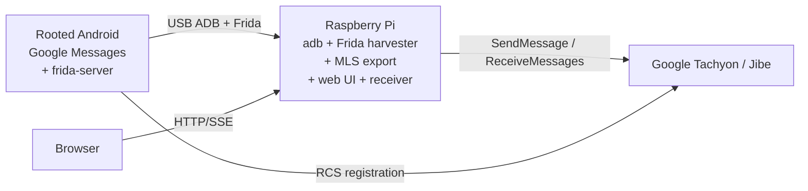

# All-in-one Pi mode

The PC is not part of the RCS protocol. It is only a convenient host for `adb`, Frida, and the MLS export. In all-in-one mode the Raspberry Pi runs everything:



After installation, the PC can be disconnected.

## Hardware

- Raspberry Pi 4 (2 GB+) or Pi 5. Pi Zero is not recommended.
- Rooted Android phone with Google Messages and working RCS.
- USB **data** cable from the phone to the Pi.
- A powered USB hub is strongly recommended: the Pi's USB ports may not supply enough current for the phone.
- Phone USB debugging enabled; `adb root` works.
- `frida-server` on the phone at a known path (default `/data/local/tmp/frida-server17`).

> **ADB over Wi-Fi** can be used for adb commands, but this project's Frida client uses USB device discovery. USB is the supported/predictable path.

## Install (on the Pi)

```bash
git clone https://github.com/zihaoRed/rcs-client.git
cd rcs-client

SENDER=+1XXXXXXXXXX \
FRIDA_SERVER=/data/local/tmp/frida-server17 \
./deploy/install_pi_allinone.sh
```

The installer:

1. installs `adb`, Python venv, Node/npm, Rust build prerequisites
2. builds the Frida agent bundle (if missing)
3. builds and installs `mls_probe` (if missing)
4. copies the web app and harvester into `/home/pi/rcsclient`
5. creates `/home/pi/rcsclient/venv`
6. writes `/home/pi/rcsclient/.env` and `work/<profile>/meta.json`
7. installs udev rules and three systemd units
8. starts `rcs-web` and `rcs-harvester`

## Connect the phone

```bash
adb devices
# should show "<serial>  device"
adb root
adb shell "ps -A | grep -i frida || nohup /data/local/tmp/frida-server17 >/data/local/tmp/frida.log 2>&1 &"
```

The `rcs-harvester` service also runs `deploy/wait_for_adb.sh`, which waits for the device, calls `adb root`, starts `frida-server` if needed, wakes the phone, and brings Messages to the foreground.

If the phone has a secure lock, unlock it once; `wm dismiss-keyguard` cannot bypass a PIN.

For an unattended appliance:

- enable Developer options → **Stay awake while charging**;
- disable battery optimization for Google Messages;
- preferably use no secure lock, or accept that the phone may need a manual unlock after a reboot;
- keep Messages in the foreground; `wait_for_adb.sh` brings it to the front without force-stopping it.

## Services

| Service | Type | Purpose |
|---|---|---|
| `rcs-web` | long-running | Flask UI + SQLite + SSE + `pi_receiver.py` supervision |
| `rcs-harvester` | long-running | waits for adb, starts frida-server, captures token/client_info/recv credentials into the local work dir |
| `rcs-mls-sync` | oneshot | exports the phone's MLS snapshot into the Pi work dir |

`rcs-web` and `rcs-harvester` are enabled at boot. `rcs-mls-sync` is installed but **not enabled** because it needs a connected, registered phone; run it manually after RCS is ready:

```bash
sudo systemctl start rcs-mls-sync
```

Check:

```bash
sudo systemctl status rcs-web rcs-harvester --no-pager
sudo journalctl -u rcs-harvester -n 50 --no-pager
curl -sS http://127.0.0.1:8090/api/state
```

Open the UI from another device on the LAN:

```
http://<PI_LAN_IP>:8090
```

## Local work directory

All credentials and state live on the Pi:

```
/home/pi/rcsclient/work/<profile>/
  send_headers.txt
  client_info.bin
  send_template.pb
  recv_phone_headers.txt
  recv_phone_frame.bin
  mls_snapshot.bin
  mls_group.json
  web.db
```

The harvester writes directly into this directory; there is no SSH push in all-in-one mode.

## Migration from PC mode

1. Copy the current profile's credentials/snapshot from the PC work directory to the Pi work directory (or simply re-capture them on the Pi).
2. Stop the PC harvester.
3. Disconnect the phone from the PC.
4. Connect the phone to the Pi via USB.
5. Run the all-in-one installer, or install only the harvester service and point it at the existing work directory.
6. Start `rcs-mls-sync` to refresh the snapshot.

## Troubleshooting

### `adb devices` shows `unauthorized`

Accept the USB debugging prompt on the phone. If the phone was connected to another host, revoke/authorize USB debugging.

### `adb devices` is empty

- Use a data cable, not a charge-only cable.
- Use a powered hub.
- Check `dmesg` for USB enumeration.
- Check udev rules: `/etc/udev/rules.d/99-android-adb.rules`.
- Try a different USB port.

### `frida-server` not running

```bash
adb shell "ps -A | grep -i frida"
adb shell "nohup /data/local/tmp/frida-server17 >/data/local/tmp/frida.log 2>&1 &"
```

The path must match the phone ABI and the Pi's `frida` Python version. Set `FRIDA_SERVER` in `/home/pi/rcsclient/.env` if it differs.

### `rcs-harvester` restarts in a loop

Check:

```bash
sudo journalctl -u rcs-harvester -n 100 --no-pager
```

Common causes: no ADB device, wrong `frida-server` path, frida version mismatch, or the phone is locked.

### `PERMISSION_DENIED` / `ERROR_NO_RETRY`

Google has temporarily blocked Tachyon registration. Stop restarting the app/network, wait, and see `docs/VERIFICATION.md` and `CLAUDE.md`.

### `mls_probe` missing

```bash
cd ~/rcs-client
./mls/build_mls_probe.sh
sudo systemctl restart rcs-web
```

### Web UI shows `AUTH_EXPIRED`

The receiver has stale ReceiveMessages credentials. Keep `rcs-harvester` running and send a plaintext RCS message from the phone; the harvester will refresh the local files and `pi_receiver.py` reloads them automatically.

## Security notes

- Phone root is still required.
- The web UI has no authentication; keep it on a trusted LAN.
- The Pi work directory contains live credentials and MLS keys; restrict filesystem access (`chmod 700` on the directory, `chmod 600` on `.env`).
- Do not expose port 8090 to the internet.
- Only use numbers you own or are authorized to test.
