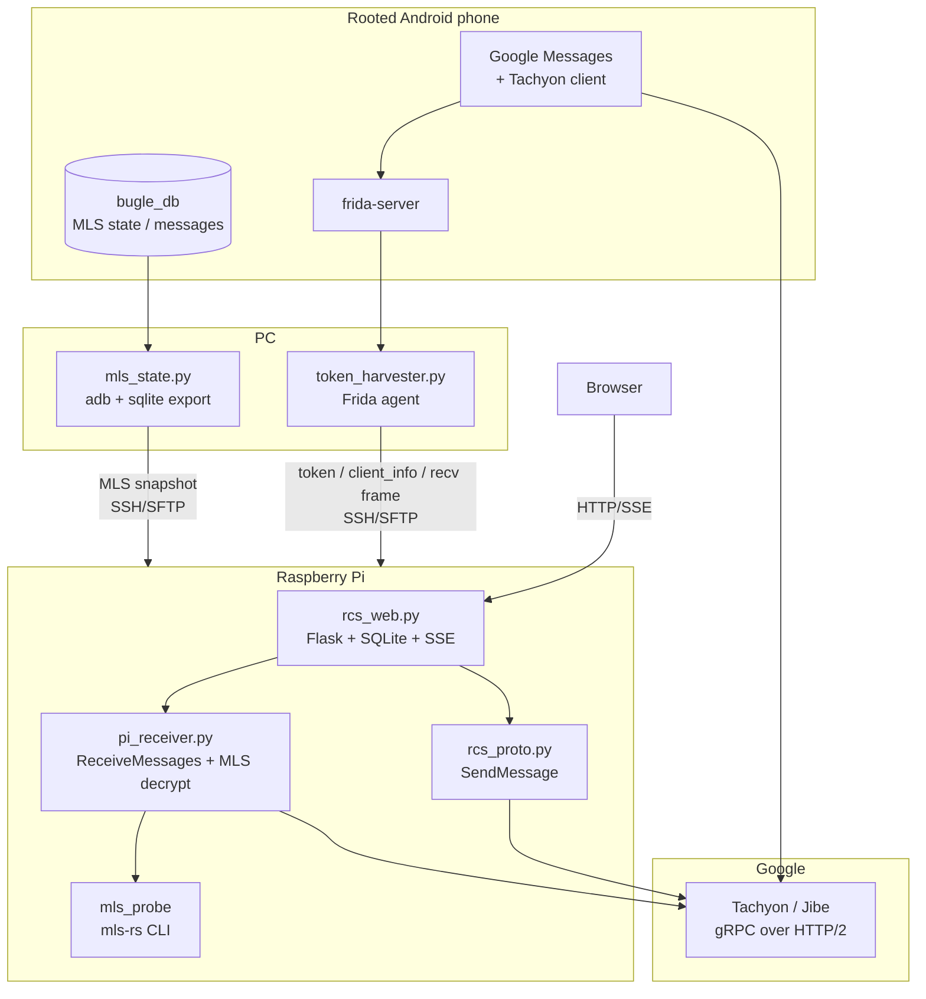

# Architecture

## Goal

Make a Raspberry Pi act as an independent RCS client while an Android phone remains the registration/credential anchor.

Non-goals:

- Mirroring the phone UI
- Sending E2EE from the Pi
- Supporting unrooted devices
- Mass messaging

## Component diagram



## Data plane

The Pi uses the same Tachyon endpoint as the phone:

```
https://instantmessaging-pa-jms-us.googleapis.com/google.internal.
communications.instantmessaging.v1.Messaging
```

Methods used:

| Method | Direction | Purpose |
|---|---|---|
| `SendMessage` | Pi → Google | send plaintext RCS |
| `ReceiveMessages` | Google → Pi | long-lived inbound stream |
| `PrewarmReceiver` | phone → Google | prewarm; request field 1 carries a 230-byte client_info |
| `PullMessages` | phone → Google | queued sync |
| `AckMessages` | phone → Google | delivery/read acks |
| `Registration/RegisterRefresh` | phone → Google | token refresh |
| `Registration/LookupRegistered` | phone → Google | registration lookup |

Transport: gRPC-Java over platform Cronet, HTTP/2 (and possibly QUIC), compressed gRPC frames.

## Credential model

There are two distinct credential sets.

### SendMessage

- header `x-goog-ext-202964622-bin` (~1715 chars)
- body field 3 `client_info` (275 bytes)
- captured from a phone `SendMessage` request
- used by `pi/rcs_proto.py`

### ReceiveMessages

- header token (~1776 chars)
- request body field 1 `client_info` (230 bytes)
- captured from a phone `ReceiveMessages` request or derived from `PrewarmReceiver` field 1
- used by `pi/pi_receiver.py`

Using SendMessage credentials on `ReceiveMessages` produces only control/IMDN and the stream is cancelled. This was the main bug in the early PoC.

Files:

```
pc/work/<profile>/
  send_headers.txt
  client_info.bin
  client_info_auto.bin
  send_template.pb
  recv_phone_headers.txt
  recv_phone_frame.bin
  recv_phone_client_info.bin
  mls_snapshot.bin
  mls_group.json
```

These are gitignored. The PC harvester pushes them to:

```
/home/pi/rcsclient/work/<profile>/
```

## MLS / E2EE

The phone is a member of a 1:1 MLS group with the peer. The Pi does not have its own MLS identity; it uses the phone's exported group snapshot.

- `mls_state.py` exports `mls_group_states.epoch_data` from `bugle_db`.
- `mls_probe` loads the snapshot with `mls-rs`.
- Inbound `message/mls` frames are decrypted with `process_incoming_message`.
- The snapshot is updated after each message/commit.
- RCS commits use `PublicProtocolMessage(Commit)` wrapped as `MB + MLS bytes` inside a nested protobuf.

RCS-specific fixes in this repo:

1. X.509 identity provider with a permissive leaf-key extractor.
2. Custom credential types (RCS uses a custom credential type on new leaves).
3. A patch to `mls-rs` `tree_index.rs` that relaxes credential-capability checks which are stricter than what the RCS app's commits satisfy.

The patch is in `mls/patches/0001-relax-credential-capability-check.patch` and is applied by `mls/build_mls_probe.sh`.

E2EE send from the Pi is rejected by the server (`MlsError`) because the Pi cannot produce the app's MLS client binding/signature. The Pi therefore sends plaintext RCS.

## Web app

`pi/rcs_web.py`:

- Flask + SQLite (`web.db` under the work profile)
- supervises `pi_receiver.py` as a child process
- tails `received.jsonl` into SQLite
- exposes:
  - `GET /api/state`
  - `GET/POST /api/contacts`
  - `GET /api/threads`
  - `GET /api/messages/<peer>`
  - `POST /api/send`
  - `POST /api/read/<peer>`
  - `GET /api/events` (SSE)
- serves a Google Messages-like UI from `pi/web/static`

The receiver writes IMDN/isComposing XML; the web app uses IMDN to update delivery/read status and publishes typing events.

## Failure model

| Failure | Effect | Recovery |
|---|---|---|
| Token/client_info stale | `grpc-status: 16` | harvester refresh + phone send |
| ReceiveMessages credential stale | receiver `AUTH_EXPIRED` | capture new 230-byte client_info |
| RCS registration blocked | `PERMISSION_DENIED` | stop churn; wait; official re-enable or new SIM |
| MLS epoch mismatch | `EpochNotFound` | process commit / re-export snapshot |
| MLS ratchet advanced | `KeyMissing` | `out_of_order` / process in order |
| Frida instability | Messages native crash | foreground app, avoid repeated attach, spare device |

## Trust boundaries

- The Pi and PC are trusted by the operator.
- The phone is the credential source and must be a controlled device.
- The web UI is LAN-only and has no authentication; do not expose it publicly.
- All captured credentials are equivalent to the phone's RCS session; treat them as secrets.
